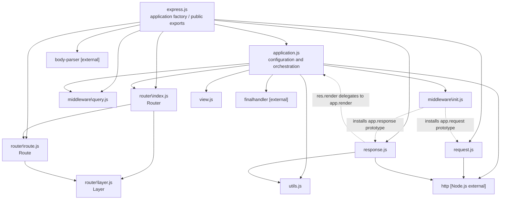

> **Recorded fallback** · GitHub Copilot CLI, read-only (`--deny-tool write --deny-tool shell`) · model gpt-6.1-sol · prompt: see docs/demo-script.md

 / Search "targets/express/lib/**/*.js" No matches found

 ✗ Shell List Express li… Permission to run this tool was denied due to the following rules: `shell`
   Get-ChildItem -LiteralPath 'C:\projects\AICodeAnalysisLecture\targets\express\lib' -File -Recurse
   | Select-Object -ExpandProperty FullName

 / Search "**\*.js" in targets\express\lib 11 files found

 JS Read targets\express\lib\express.js 116 lines read

 JS Read targets\express\lib\router\index.js L1:360 (360 lines read)

 JS Read targets\express\lib\application.js L1:400 (400 lines read)

 JS Read targets\express\lib\router\layer.js 181 lines read

 JS Read targets\express\lib\router\route.js 230 lines read

 JS Read targets\express\lib\application.js L401:660 (260 lines read)

 JS Read targets\express\lib\router\index.js L340:680 (334 lines read)

 JS Read targets\express\lib\middleware\query.js 47 lines read

 JS Read targets\express\lib\middleware\init.js 42 lines read

 JS Read targets\express\lib\view.js 182 lines read

 JS Read targets\express\lib\request.js L1:520 (520 lines read)

 JS Read targets\express\lib\response.js L1:340 (340 lines read)

 JS Read targets\express\lib\utils.js L1:440 (303 lines read)

 / Search "require\(|function createApplication|var app = function|app.handle|mixin\… 21 lines found

 / Search "proto.handle|var done =|req.next|next\(\)|function next|idx >=|setImmedia… 42 lines found

 / Search "require\(|app\.(lazyrouter|handle|use|route|engine|set|render|listen)|new… 64 lines found

 / Search "this.handle|pathRegexp\(|prototype\.|fn.length|fn\(|catch|next\(|this.par… 30 lines found

 / Search "function Route|this.stack|this.methods|prototype.dispatch|next\(\)|functi… 32 lines found

 / Search "require\(|Object.create|res\.(json|send|render)|this.send\(body|this.end… 144 lines found

 JS Read targets\express\lib\response.js L1026:1051 (25 lines read)

 JS Read targets\express\lib\response.js L1140:1177 (37 lines read)

 / Search "^" in *.js (targets\express\lib\middleware) 90 lines found

 / Search "^" in *.js (targets\express\lib\router\route.js) 155 lines found

 / Search "^" in *.js (targets\express\lib\application.js) 185 lines found

# Express 4.21.2: `lib` architecture

Scope: read-only analysis of `targets\express\lib` only. All references below are relative to that directory. External dependency internals were not inspected; behavior not established within this scope is labeled **inferred**.

## 1. Main components and dependencies

Solid arrows represent direct `require()` dependencies; dotted arrows represent runtime collaboration. Selected external dependencies are explicitly marked.



Dependency evidence: `express.js:15-22,79`; `application.js:16-26`; `router\index.js:16-17`; `router\route.js:18`; `request.js:20`; `response.js:21-30`. Runtime links: `middleware\init.js:35-36`, with prototypes created at `express.js:46-53`; rendering delegation at `response.js:1049`.

## 2. Component responsibilities

| Component | File | Responsibility |
|---|---|---|
| Public API / application factory | `express.js` | Creates callable apps, mixes in application/EventEmitter methods, creates per-app request/response prototypes, and exports routing and middleware APIs. |
| Application | `application.js` | Manages configuration, lazy router initialization, middleware/routes, mounted apps, view engines/caches, final handling, and HTTP server creation. |
| Router | `router\index.js` | Traverses ordered layers; matches paths/methods; assigns parameters; processes parameter callbacks; manages mounted prefixes and error propagation. |
| Layer | `router\layer.js` | Wraps a callback with path matching, parameter decoding, handler-arity checks, and synchronous exception forwarding. |
| Route | `router\route.js` | Maintains a path-specific, method-filtered handler stack; dispatches handlers and implements route/router escape signals. |
| Query middleware | `middleware\query.js` | Populates `req.query`, unless already present, using the configured parser; calls `next()`. |
| Initialization middleware | `middleware\init.js` | Links request/response objects, installs Express prototypes, initializes response locals, and optionally adds `X-Powered-By`. |
| Request extensions | `request.js` | Extends Node’s request prototype with header, negotiation, range, URL, proxy, and freshness helpers. |
| Response extensions | `response.js` | Extends Node’s response prototype with sending, JSON/JSONP, headers, cookies, file delivery, redirects, and rendering helpers. |
| Shared utilities | `utils.js` | Compiles configurable ETag/query/trust functions and provides content-type, charset, and other normalization helpers. |
| View | `view.js` | Resolves template files, loads/reuses engine functions, and invokes the selected engine. |

## 3. Identifiable design patterns

Pattern names are architectural interpretations; the cited operations are directly observable.

| Pattern | Code evidence |
|---|---|
| **Factory with mixin composition** | `express.js:37-55` creates a callable application, mixes in EventEmitter/application behavior, initializes it, and returns it. |
| **Prototype-based extension** | `request.js:31` and `response.js:43` derive from Node HTTP prototypes; `express.js:46-53` adds per-app prototypes; `middleware\init.js:35-36` installs them on live objects. |
| **Chain of Responsibility / middleware pipeline** | `router\index.js:225` advances the outer stack; `router\index.js:328` passes its `next` to a layer. `router\route.js:137-149` implements the inner handler chain. A handler can respond instead of advancing. |
| **Callback wrapper / decorator-like behavior** | `router\layer.js:41,45` associates a callback with matching metadata; `router\layer.js:86-99` surrounds invocation with arity filtering and exception forwarding. |
| **Strategy / pluggable behavior** | `utils.js:150-172,182-205,215-235` selects or accepts ETag, query-parser, and trust functions. `view.js:91,135` selects and invokes a template-engine function. |
| **Lazy initialization** | `application.js:144-153` creates the router and built-in middleware only when `_router` is absent. |
| **Observer / event notification** | `application.js:96-109` subscribes to `mount`; `application.js:245` emits it when mounting a child app. |
| **Facade / delegation** | `application.js:489-501` exposes HTTP-method APIs while delegating registration to Router/Route; `express.js:78` exposes external `body-parser.json` as `express.json`. |
| **Cache-aside** | `application.js:579-605` checks the enabled view cache, constructs missing views, and stores them. `view.js:75-91` similarly loads missing engine functions into the engine registry. |
| **Fluent interface** | `application.js:498-500` returns the application after route registration; `router\route.js:221-228` returns the route after adding handlers. |

## 4. `GET /users/42` request sequence

For the supplied configuration:

```js
app.use(express.json());
app.get('/users/:id', (req, res) => res.json({ id: req.params.id }));
```

The outer router stack is **query → expressInit → JSON middleware → route layer**. Built-ins are installed first by `application.js:151-152`; `app.use` appends middleware through `application.js:227` and `router\index.js:475-483`. Route registration creates an outer layer bound to `Route.dispatch` (`router\index.js:502-513`) and an inner GET-handler layer (`router\route.js:206-225`).

Assumptions: a server has been created, default settings remain unchanged, and the JSON middleware continues successfully. Server request delivery and the external JSON middleware’s continuation are **inferred**. The snippet itself does not start a server.

`Layer` below represents several **distinct instances**, not one shared object. Additional participants expose middleware callbacks and the response/error boundaries.

```mermaid
sequenceDiagram
    participant HTTP as http server
    participant App as app
    participant Router
    participant Layer
    participant Query as query middleware
    participant Init as expressInit
    participant JSON as JSON middleware (external)
    participant Route
    participant Handler as handler
    participant Res as res
    participant Final as finalhandler (external)

    HTTP->>App: GET /users/42, req/res [inferred delivery; listener registration application.js:634]
    App->>App: app.handle(req,res,next) [express.js:38-39]
    Note over App,Final: Default done callback created at application.js:169-172
    App->>Router: handle(req,res,done) [application.js:181]
    Router->>Router: Begin next(); select stack[idx++] [router\index.js:175,225]

    Router->>Layer: Query layer.handle_request(req,res,next) [router\index.js:328]
    Layer->>Query: fn(req,res,next) [router\layer.js:95]
    Query->>Router: next() advances outer stack [middleware\query.js:45; router\index.js:225]

    Router->>Layer: Init layer.handle_request(req,res,next) [router\index.js:328]
    Layer->>Init: fn(req,res,next) [router\layer.js:95]
    Note over Init,Res: Link objects and install prototypes [middleware\init.js:31-38]
    Init->>Router: next() advances outer stack [middleware\init.js:40; router\index.js:225]

    Router->>Layer: JSON layer.handle_request(req,res,next) [router\index.js:328]
    Layer->>JSON: fn(req,res,next) [router\layer.js:95; express.js:78]
    JSON->>Router: next() [inferred external continuation; callback supplied router\index.js:328]

    Router->>Layer: Match /users/42 against route layer [router\index.js:225-226,583-585]
    Layer->>Layer: Execute regexp; decode and capture id="42" [router\layer.js:129,139-151,172]
    Router->>Route: _handles_method("GET") [router\index.js:249-250]
    Router->>Router: Assign req.params; process params, no registered callbacks [router\index.js:274-280,375-376]
    Router->>Layer: Outer route layer.handle_request(req,res,next) [router\index.js:284]
    Layer->>Route: Bound dispatch(req,res,routerNext) [router\layer.js:95; router\index.js:509]
    Route->>Route: next(); select inner GET layer [router\route.js:119,137-149]
    Route->>Layer: Inner handler layer.handle_request(req,res,routeNext) [router\route.js:149]
    Layer->>Handler: fn(req,res,next) inside try [router\layer.js:94-95]

    alt Handler responds normally
        Handler->>Res: json({id:"42"}) [user snippet, no lib call site; inferred invocation; response.js:250]
        Res->>Res: Stringify; set JSON content type; send(body) [response.js:271-278]
        Res->>Res: end(chunk,encoding) for GET [response.js:227-232]
        Note over Handler,Router: No next() call: neither stack advances automatically [router\layer.js:94-99]
    else Handler synchronously throws an ordinary Error before responding
        Handler-->>Layer: Throw reaches invocation catch [hypothetical throw; router\layer.js:95-97]
        Layer->>Route: routeNext(err) [router\layer.js:97]
        Route->>Route: Advance inner stack; no layer remains [router\route.js:137-140]
        Route->>Router: done(err), which is routerNext(err) [router\route.js:141; router\index.js:284]
        Router->>Router: Outer stack exhausted; schedule done(err) [router\index.js:202-204]
        Router->>Final: Restored out(err) callback [router\index.js:631-646; application.js:169-172]
        Note over Final,HTTP: Error response details, including usual 500 behavior, are inferred: finalhandler internals are outside scope
    end
```

**`next()` semantics:** Router and Route have separate stack indices and continuation functions. If the single route handler called its supplied `next()` instead of responding, Route would exhaust its stack and resume Router (`router\route.js:137-141`); Router would then exhaust its stack and invoke final handling (`router\index.js:202-204`). Returning normally does **not** call `next()` (`router\layer.js:94-99`).

**Error semantics:** With further layers present, a pending error skips ordinary routes (`router\index.js:240-243`) and invokes middleware error dispatch (`router\index.js:325-328`). Only four-argument callbacks qualify as error handlers (`router\layer.js:62-73`). The depicted catch handles synchronous throws; it does not observe returned promises (`router\layer.js:94-97`).
