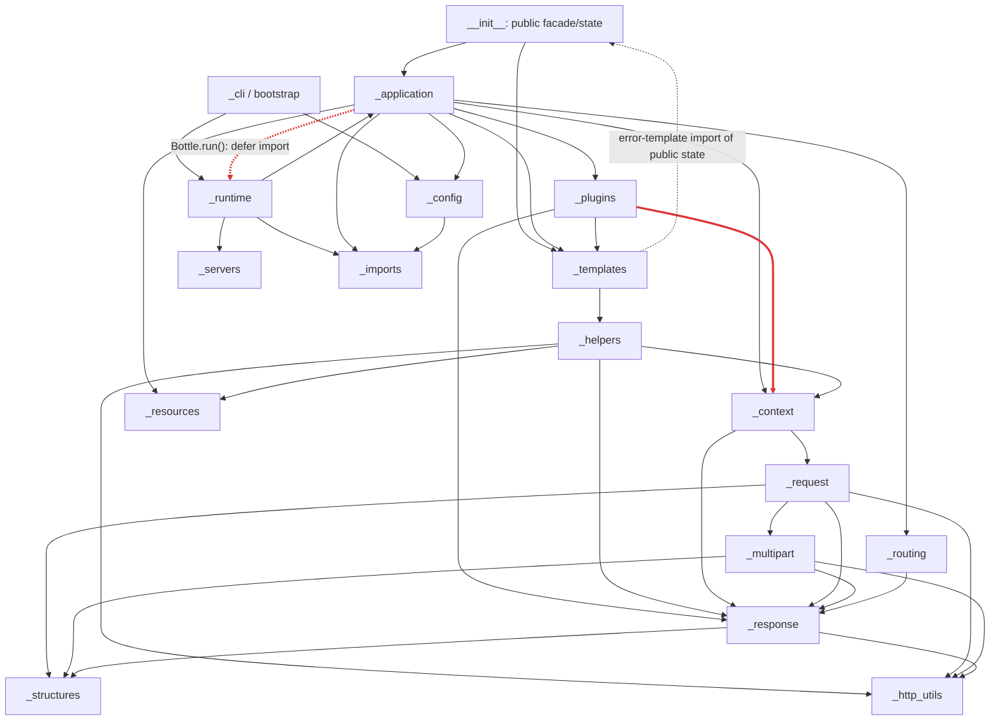

> **Recorded fallback** · GitHub Copilot CLI, read-only (`--deny-tool write --deny-tool shell`) · model gpt-6.1-sol · prompt: see docs/demo-script.md

I’ll map the code boundaries, dependencies, and module-level API without changing files. I’ll also account for Bottle’s deliberate single-file design and easy-vendoring trade-off.

 ✗ Shell Inspect worktre… Permission to run this tool was denied due to the following rules: `shell`
   git --no-pager status --short; @'
   import ast
   from pathlib import Path
   p = Path('bottle.py')
   s = p.read_text(encoding='utf-8')
   t = ast.parse(s)
   for n in t.body:
       if isinstance(n, (ast.FunctionDef, ast.AsyncFunctionDef, ast.ClassDef)):
           print('%4d-%4d %-10s %s' % (min([n.lineno] + [d.lineno for d in n.decorator_list]),
   n.end_lineno, type(n).__name__, n.name))
       elif isinstance(n, (ast.Import, ast.ImportFrom, ast.Assign, ast.AnnAssign)):
           text = ast.get_source_segment(s,n).splitlines()[0]
           print('%4d-%4d %-10s %s' % (n.lineno,n.end_lineno,type(n).__name__,text[:180]))
       elif isinstance(n, (ast.If,ast.Try)):
           print('%4d-%4d %-10s %s' %
   (n.lineno,n.end_lineno,type(n).__name__,s.splitlines()[n.lineno-1].strip()))
   '@ | python -

 / Search "{setup.py,pyproject.toml,tox.ini,setup.cfg,Makefile,README*,CONTRIBUTING*,… 7 files found

 / Search "{test,tests,doc,docs}/**/*" 209 files found

 PY Read bottle.py L1:380 (380 lines read)

 PY Read bottle.py L4450:4681 (231 lines read)

 ● Read tox.ini 18 lines read

 YM Read .github\workflows\run_tests.yml 24 lines read

 PY Read setup.py 49 lines read

 / Search "^(class |def |[A-Za-z_][A-Za-z_0-9]*\s*=|#.*(###|Routing|Request|Respons… 198 lines found

 PY Read bottle.py L380:790 (411 lines read)

 PY Read bottle.py L791:1151 (359 lines read)

 PY Read bottle.py L1152:1420 (268 lines read)

 PY Read bottle.py L1421:1700 (279 lines read)

 PY Read bottle.py L1701:1990 (290 lines read)

 PY Read bottle.py L1991:2358 (367 lines read)

 PY Read bottle.py L2357:2652 (294 lines read)

 PY Read bottle.py L2653:2949 (297 lines read)

 PY Read bottle.py L2950:3217 (266 lines read)

 PY Read bottle.py L3218:3466 (248 lines read)

 PY Read bottle.py L3467:3843 (377 lines read)

 PY Read bottle.py L3844:4042 (197 lines read)

 PY Read bottle.py L4043:4280 (236 lines read)

 PY Read bottle.py L4281:4471 (189 lines read)

 PY Read test\__init__.py 13 lines read

 ● Read setup.cfg 5 lines read

 PY Read test\test_importhook.py 40 lines read

 ● Read docs\development.rst 171 lines read

 ● Read docs\api.rst 230 lines read

 ● Read README.rst 73 lines read

 / Search "^__all__|__name__|__file__|\b(DEBUG|NORUN|TEMPLATE_PATH|TEMPLATES|ERROR_P… 46 lines found

 / Search "bottle\.[A-Za-z_][A-Za-z_0-9]*\s*=|from bottle import|bottle\.(DEBUG|NORU… 36 lines found

The main compatibility risk is shared state, not class placement: simple re-exports would disconnect internal code from reassigned globals such as `bottle.DEBUG` and `bottle.TEMPLATE_PATH`. The proposal will account for that, the `bottle.ext` import hook, and CLI monkey-patching that must happen before framework imports.

 PY Read test\tools.py L1:200 (178 lines read)

 PY Read test\test_contextlocals.py 41 lines read

 PY Read test\test_stpl.py L1:120 (120 lines read)

 / Search "^    def (run|route|default_error_handler|load_module|push|prepare|apply… 195 lines found

 / Search "bottle\.[_A-Za-z][_A-Za-z0-9]*" in test\*.py 235 lines found

 / Search "single.file|monkey.patch|python.*bottle|bottle.py|pytest|unittest" in {Ma… 15 lines found

 PY Read test\test_sendfile.py L1:95 (95 lines read)

 PY Read test\test_wsgi.py L116:132 (17 lines read)

 / Search "^from |^import |^    (from |import |[A-Za-z_][A-Za-z_0-9]* =)|^    class … 85 lines found

 / Search "__module__|__name__|__file__|bottle.py|pickle|reload\(" in test\*.py 42 lines found

**A package split is feasible, but preserving Bottle’s API requires more than re-exporting classes.** Shared globals, class identities, import hooks, and CLI initialization order are compatibility constraints. Bottle’s single-file design deliberately makes vendoring trivial; modularization would trade that advantage for clearer internal boundaries. **I recommend retaining the single-file distribution.**

No files changed. All ranges below refer to the supplied `bottle.py`, version `0.13.2`.

## 1. Proposed decomposition

Use private module names to avoid collisions: a public `bottle.template` submodule, for example, could overwrite the existing callable `bottle.template`.

Ranges include closely associated helpers and intervening whitespace, not just class bodies.

| Proposed module | Classes/functions belonging together | Current line ranges |
|---|---|---|
| `_core.py` | Python compatibility imports, JSON backend selection, string conversion, `update_wrapper`, `depr`, `makelist`, descriptors, `BottleException`, HTML escaping | **72–261**, **3101–3110** |
| `_imports.py` | `_ImportRedirect`, object/module loader `load` | **2065–2104**, **3846–3863** |
| `_config.py` | `_UNSET`, `ConfigDict`, overlays, metadata and configuration loading | **2357–2595** |
| `_structures.py` | `_hkey`, `_hval`, `HeaderProperty`; `MultiDict`, `FormsDict`, `HeaderDict`, `WSGIHeaderDict` | **1605–1633**, **2111–2355** |
| `_http_utils.py` | Date/auth/range/header/query parsing; cookie encoding; `path_shift`; HTTP status tables | **2960–3098**, **3133–3161**, **4548–4556** |
| `_response.py` | `BaseResponse`, `Response` alias, `HTTPResponse`, `HTTPError` | **1636–1907**, **1953–1988** |
| `_multipart.py` | `MultipartError`, `_MultipartParser`, `_MultipartPart` | **3218–3457** |
| `_request.py` | `BaseRequest`, `Request` alias, `FileUpload` | **1152–1602**, **1952**, **2739–2803** |
| `_context.py` | `_local_property`, `LocalRequest`, `LocalResponse`; singleton `request`, `response`, `local` | **1910–1949**, **4602–4609** |
| `_routing.py` | Routing exceptions, `_re_flatten`, `Router`, `Route`, `yieldroutes` | **268–606**, **3113–3130** |
| `_resources.py` | `WSGIFileWrapper`, `_closeiter`, `ResourceManager` | **2623–2736** |
| `_helpers.py` | `abort`, `redirect`, `_rangeiter`, `static_file`, `auth_basic` | **2810–2944**, **3164–3183** |
| `_templates.py` | Template exceptions and adapters, `SimpleTemplate`, `StplParser`, rendering/view functions and specialized aliases | **4043–4536** |
| `_plugins.py` | `PluginError`, `JSONPlugin`, `TemplatePlugin` | **1995–2062** |
| `_application.py` | `Bottle`, `AppStack`, `make_default_app_wrapper`, default-application shortcuts | **613–1145**, **2600–2620**, **3187–3208** |
| `_servers.py` | `ServerAdapter`, all concrete adapters, `server_names` registry | **3467–3839** |
| `_runtime.py` | `debug`, `load_app`, `_debug`, `run`, `FileCheckerThread` | **2952–2957**, **3866–4036** |
| `_cli.py` and bootstrap | Argument parsing, early monkey-patching, `_main`, `main`, executable guards | **31–66**, **4621–4680** |
| `__init__.py` compatibility facade | Metadata, re-exports, authoritative public settings, default-app aliases, extension-hook initialization | **19–21**, **4542–4545**, **4559–4597**, **4613–4618**, plus exports from every cluster |

Three boundaries matter particularly:

- **Response below request:** multipart errors inherit `HTTPError` (**3218–3220**), while request parsing uses the multipart parser (**1388–1421**). Keeping response independent avoids a request–multipart import cycle.
- **Headers below response:** both responses and multipart/upload handling use the header structures. Moving those structures together avoids response/container cross-imports.
- **`Route` need not import `Bottle`:** its application is supplied to the constructor (**509–533**). Plugin application uses the supplied objects, not imports of concrete plugin classes.

## 2. Dependency graph and cycles

Arrows mean **“uses.”** Common `_core` dependencies and most facade re-export edges are omitted for readability. Red dashed edges identify runtime back-references that must **not** become eager circular imports.



**Cycle 1: application ↔ runtime.** `Bottle.run()` calls the module-level runner (**859–861**); the runner obtains the default application (**3945–3948**). Resolve import initialization with a method-local import or an injected runner—not mutually importing modules at top level.

**Cycle 2: facade → application/templates → facade.** The default error template dynamically imports `DEBUG` and `request` from the public module (**4559–4561**, **4597**), while `Bottle.default_error_handler()` invokes templating (**974–975**). Preserve this as a deferred runtime lookup. Moving the template unchanged would substitute the internal module’s `__name__`, changing its import target.

**Shared-state coupling extends beyond these edges.** `depr`, routing, resource caching, application dispatch and templates read `DEBUG` (**185**, **429**, **849**, **2721**, **4134**, **4485**). These are runtime dependencies even if import statements do not reveal them.

## 3. Required `bottle.__init__` exports

### Bottle-defined public names

The following should remain available through `import bottle` and explicit `from bottle import …` imports:

```text
Application and routing:
Bottle, AppStack, Router, Route,
BottleException, RouteError, RouteReset, RouterUnknownModeError,
RouteSyntaxError, RouteBuildError,
app, apps, default_app,
route, get, post, put, delete, patch, error, mount, hook,
install, uninstall, url,
make_default_app_wrapper, yieldroutes

HTTP, context and containers:
BaseRequest, Request, LocalRequest,
BaseResponse, Response, LocalResponse,
HTTPResponse, HTTPError, MultipartError,
request, response, local,
MultiDict, FormsDict, HeaderDict, WSGIHeaderDict,
HeaderProperty, FileUpload, ConfigDict,
abort, redirect, static_file, auth_basic,
http_date, parse_date, parse_auth, parse_range_header,
cookie_encode, cookie_decode, cookie_is_encoded, path_shift,
HTTP_CODES

Utilities and runtime:
tob, touni, tonat, update_wrapper, depr, makelist,
DictProperty, cached_property, lazy_attribute,
html_escape, html_quote, WSGIFileWrapper, ResourceManager,
load, load_app, debug, run, FileCheckerThread, main

Plugins:
PluginError, JSONPlugin, TemplatePlugin, ext

Templates:
TemplateError, BaseTemplate, MakoTemplate, CheetahTemplate,
Jinja2Template, SimpleTemplate, StplSyntaxError, StplParser,
template, view,
mako_template, cheetah_template, jinja2_template,
mako_view, cheetah_view, jinja2_view,
TEMPLATE_PATH, TEMPLATES, ERROR_PAGE_TEMPLATE

Servers:
ServerAdapter, CGIServer, FlupFCGIServer, WSGIRefServer,
CherryPyServer, CherootServer, WaitressServer, PasteServer,
MeinheldServer, FapwsServer, TornadoServer, AppEngineServer,
TwistedServer, DieselServer, GeventServer, GunicornServer,
EventletServer, BjoernServer, AsyncioServerAdapter,
AiohttpServer, AiohttpUVLoopServer, AutoServer, server_names

Other settings and metadata:
DEBUG, NORUN, __author__, __version__, __license__
```

Their definition ranges are enumerated in the decomposition table.

### Existing imported names also matter

There is **no module-level `__all__`**. Consequently, strict namespace compatibility includes imported and compatibility names from **16–17** and **72–160**, not only documented framework APIs:

```text
print_function, sys,
base64, calendar, email, functools, hmac, itertools, mimetypes,
os, re, tempfile, threading, time, warnings, weakref, hashlib,
FunctionType, datedate, datetime, timedelta, NamedTemporaryFile,
format_exc, print_exc, normalize,
json_dumps, json_lds, json_loads,
py, py3k, httplib, thread,
urljoin, UrlSplitResult, urlencode, urlquote, urlunquote,
SimpleCookie, Morsel, CookieError, DictMixin, new_module,
pickle, BytesIO, configparser, UTC, getargspec, unicode, imap
```

Preserve interpreter-conditional names too: Python 3 defines `timezone`, `getfullargspec`, `basestring`, and `callable`; the Python 2 branch imports `tzinfo`. Do not accidentally narrow existing wildcard imports by introducing a restrictive `__all__`.

This is not merely theoretical: tests explicitly import `CookieError`, `BytesIO`, `UTC`, and `new_module`.

### Re-exporting alone is insufficient

| Compatibility requirement | Necessary treatment |
|---|---|
| Aliases | Preserve `Request is BaseRequest`, `Response is BaseResponse`, and `apps is app is default_app` (**1952–1953**, **4613**). |
| Singleton identity | Create request/response locals once; every consumer must share them (**4602–4609**). |
| Public settings | Keep one authoritative namespace. Internal code must observe assignments such as `bottle.DEBUG = 'strict'` or `bottle.TEMPLATE_PATH = [...]`; copied imports become stale. Both mutation and rebinding matter. |
| Public class identity | Preserve public `__module__` values where observable, including exception representations and pickle paths. `test\test_wsgi.py:129` expects exactly `<class 'bottle.HTTPError'>`. |
| Private compatibility | Retain at least `_re_flatten`, `_parse_http_header`, and `_MultipartParser`: existing tests import/use them directly. A strictly mechanical split should initially retain all existing private attributes. |
| Extension imports | Preserve `bottle.ext.* → bottle_*`, register the hook once, and retain a valid `ext.__file__` (**2065–2104**, **4617–4618**). |
| Monkey-patching | If existing public-name monkey-patching must remain effective, affected internal calls must resolve through the facade rather than capture independent bindings. |

A small, explicitly initialized facade-state accessor is preferable to a module-assignment proxy, especially while Python 2 compatibility remains in scope.

## 4. Migration order with green checkpoints

This is a proposed sequence, not a claim that the refactor has been executed.

1. **Freeze compatibility first.** Record the existing namespace per supported interpreter, signatures, aliases, singleton identities and public class module names. Add focused regression cases for setting rebinding, extension imports, error rendering, and CLI startup. Establish a green baseline.

2. **Introduce the package shell atomically.** Initially place the unchanged implementation in `bottle\__init__.py`, preserving its module name. Update packaging from `py_modules` to package discovery and retain the `bottle:main` entry point. Do not leave competing implementations on the same import path. Resolve executable/bootstrap behavior in this same checkpoint.

3. **Extract foundations.** Move `_core`, `_imports`, `_config`, `_structures`, `_http_utils`, and `_resources`, retaining root exports immediately. Keep `getargspec` and `makelist` together; the former calls the latter (**107–110**).

4. **Extract HTTP bottom-up.** Move `_response`, then `_multipart`, `_request`, and `_context`. Exercise existing environment, multipart, cookie, upload and thread-local tests. Preserve public exception module names before moving on.

5. **Extract routing and request helpers.** Move `_routing` and `_helpers`; exercise router, route, authentication, static-file and mount behavior.

6. **Extract templates, then plugins.** Preserve specialized partials, template cache/path settings, error-template imports and optional dependency loading. Exercise SimpleTemplate, Mako, Jinja2, plugin and output-filter tests.

7. **Extract application, servers and runtime.** Move `Bottle`, `AppStack`, shortcuts and adapters, then the runner/reloader. Defer the `Bottle.run()` back-reference. Preserve lazy creation of the first default application (**2600–2620**, **4611–4613**).

8. **Verify distribution and invocation parity.** Run the full suite against an installed package, not just the checkout; exercise console entry points, `python -m bottle`, reload subprocesses and optional adapter imports. Preserve the supported interpreter matrix rather than combining this work with a Python-version migration.

At each checkpoint, run targeted tests followed by the existing suite before proceeding. The repository already specifies `python -m unittest discover` in `tox.ini`; CI uses `pytest . -ra -q --cov=bottle --cov-report=term`.

**CLI caveat:** the source intentionally patches gevent/eventlet before importing threading and other framework dependencies (**26–28**, **53–66**, **72–73**). With a package, `python -m bottle` imports `__init__` before executing `__main__`. An eager facade plus a trivial `__main__` wrapper therefore does **not** preserve initialization order; the bootstrap must handle this before eager framework initialization.

## 5. Recommendation

**Do not replace Bottle’s single-file distribution solely for modularity.** The existing file already has clear subsystem sections, and copy-one-file deployment is an explicit product feature—not accidental technical debt (**bottle.py:4–8**; `README.rst`, installation section).

A package would improve navigation and ownership boundaries, but introduce import-order, shared-state, packaging and compatibility machinery. Consider modular development sources with a generated standalone release only if maintenance pain becomes demonstrable—and only with parity checks for both artifacts. Otherwise, stronger boundary documentation and focused tests provide much of the benefit without sacrificing Bottle’s defining vendoring advantage.
